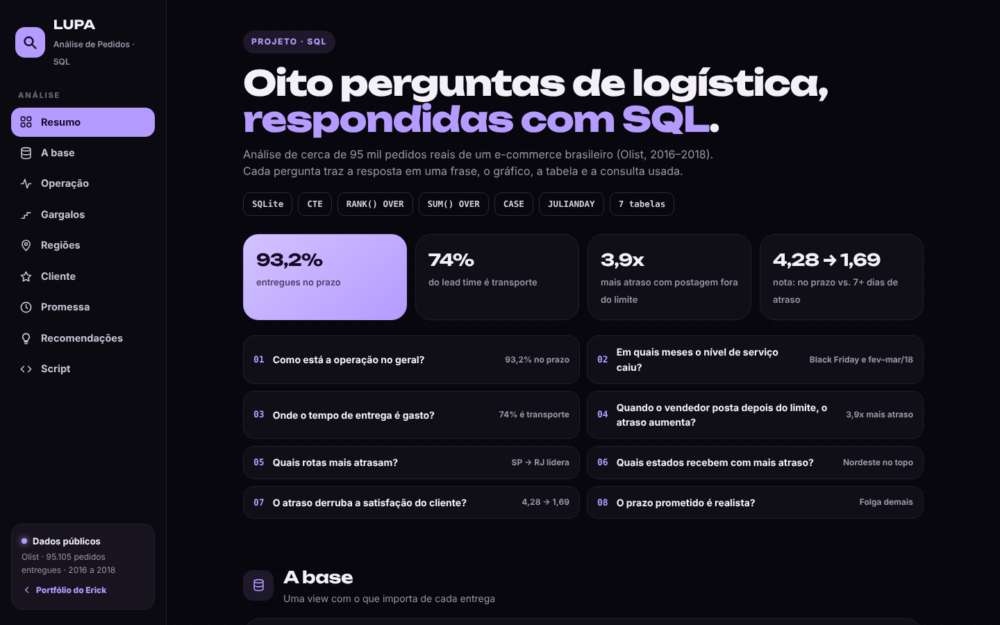
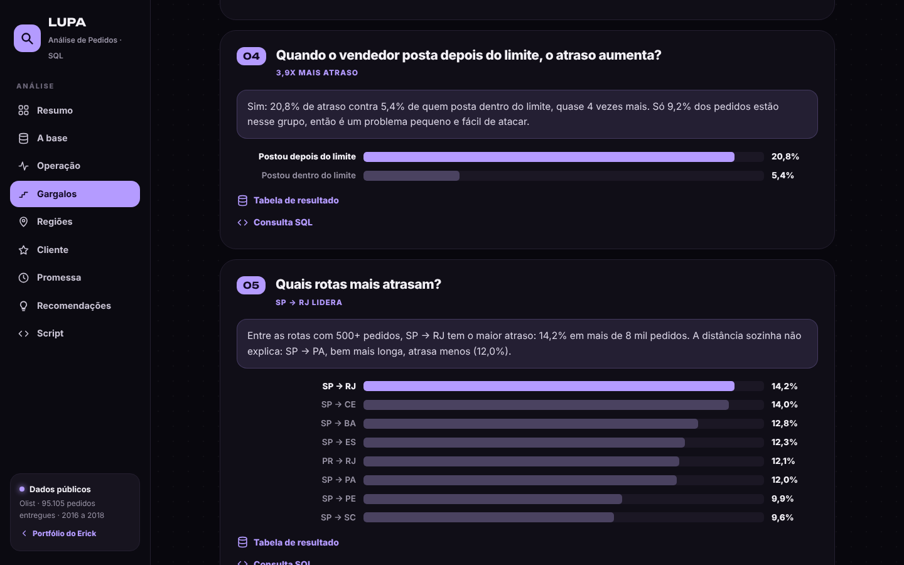

# LUPA · Análise de Pedidos com SQL

**Site:** https://erickkamorim.github.io/analise-pedidos-sql/

Oito perguntas que um time de logística faria, respondidas com SQL sobre **cerca de 95 mil pedidos reais** de um e-commerce brasileiro (Olist, 2016–2018). Cada pergunta traz a resposta em uma frase, o gráfico, a tabela de resultado e a consulta usada.



## As perguntas

| # | Pergunta | Resposta curta |
|---|---|---|
| 01 | Como está a operação no geral? | 93,2% no prazo, lead time de 12,6 dias |
| 02 | Em quais meses o nível de serviço caiu? | nov/2017 (Black Friday) e fev–mar/2018 |
| 03 | Onde o tempo de entrega é gasto? | 74% é transporte |
| 04 | Postar depois do limite aumenta o atraso? | 20,8% vs. 5,4% (3,9x) |
| 05 | Quais rotas mais atrasam? | SP → RJ, 14,2% em 8 mil pedidos |
| 06 | Quais estados recebem com mais atraso? | Nordeste no topo, Alagoas com 21,1% |
| 07 | O atraso derruba a satisfação? | nota de 4,28 para 1,69 com 7+ dias de atraso |
| 08 | O prazo prometido é realista? | 73,7% chegam 8+ dias antes do prazo |



## Técnicas de SQL usadas

- **View base** (`vw_entregas`) para centralizar regras e evitar repetição
- **CTEs** (`WITH`) para organizar consultas em etapas
- **Funções de janela:** `RANK() OVER` para ranking de estados e `SUM() OVER ()` para percentual do total
- **CASE** para faixas de atraso e classificação de postagem
- **JULIANDAY** para calcular intervalos em dias entre datas
- **JOINs** entre 7 tabelas (pedidos, itens, clientes, vendedores, produtos, avaliações e pagamentos)

## Como rodar

```bash
# baixe os CSVs da Olist no Kaggle e coloque numa pasta "olist"
cd scripts
python rodar_consultas.py ../olist
```

O script carrega os CSVs em SQLite e executa todas as consultas de `analise_pedidos.sql`.

## Estrutura

```
index.html                   site da análise
analise_pedidos.sql          view base + as 8 consultas comentadas
scripts/rodar_consultas.py   carrega os dados e roda as consultas
img/                         prints usados neste README
```

## Fonte dos dados

[Brazilian E-Commerce Public Dataset by Olist](https://www.kaggle.com/datasets/olistbr/brazilian-ecommerce), Kaggle, licença CC BY-NC-SA 4.0.

Veja também o dashboard dos mesmos dados: [FLUXO](https://erickkamorim.github.io/performance-logistica/)

---

**Erick Amorim** · [Portfólio](https://erickkamorim.github.io/) · [LinkedIn](https://www.linkedin.com/in/erickkamorim)
